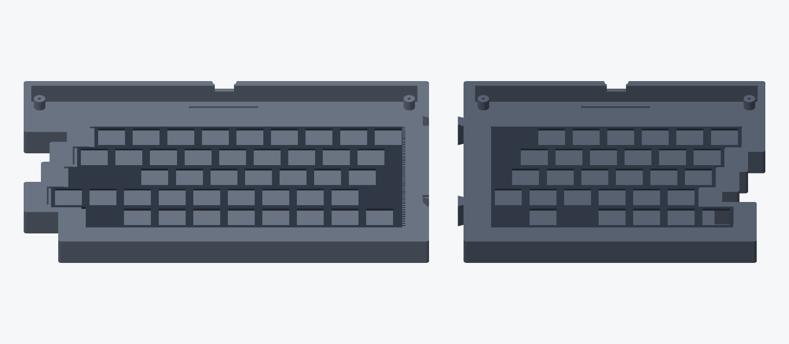
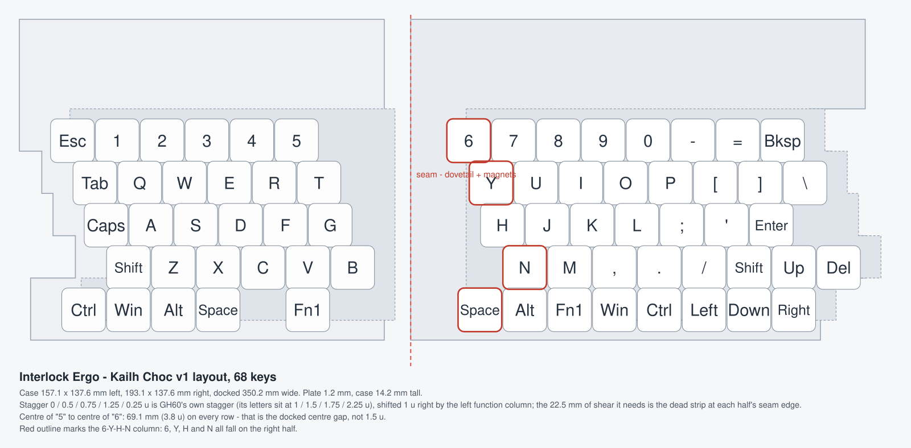
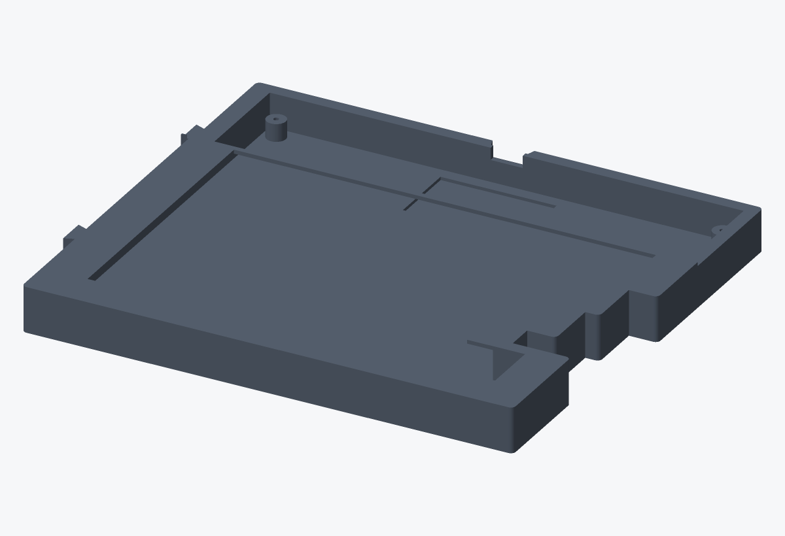
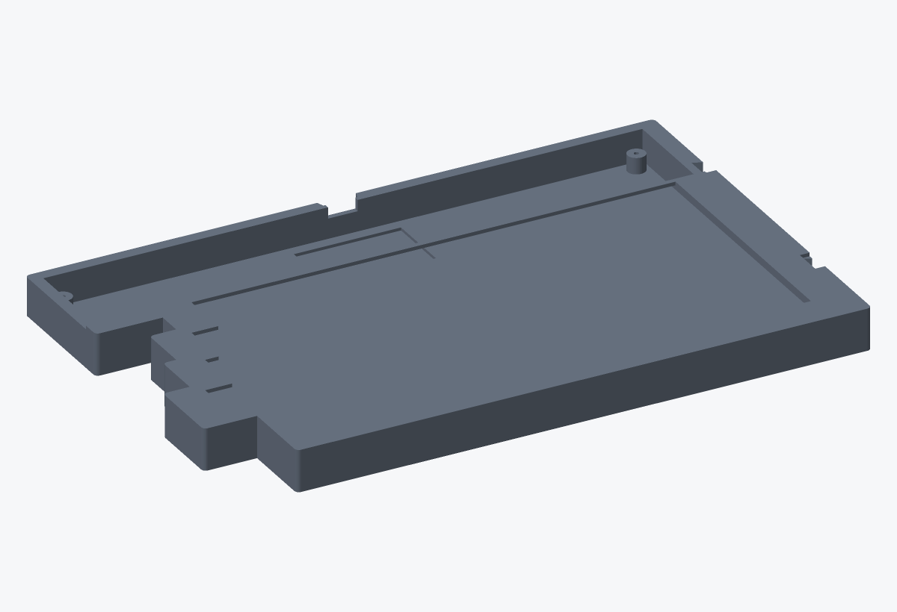
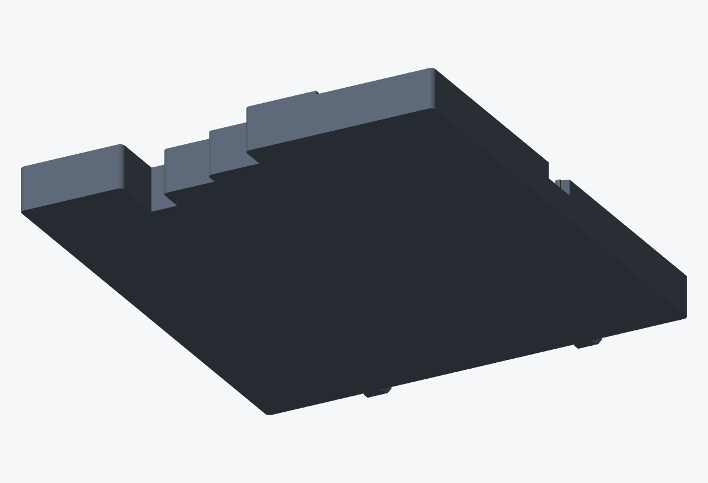
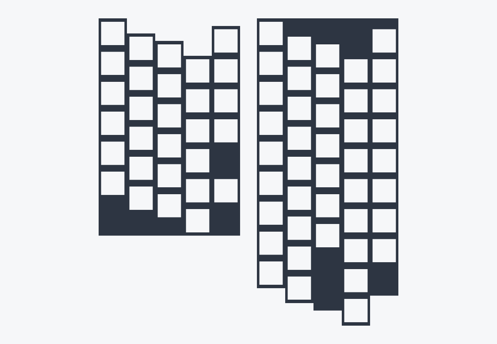
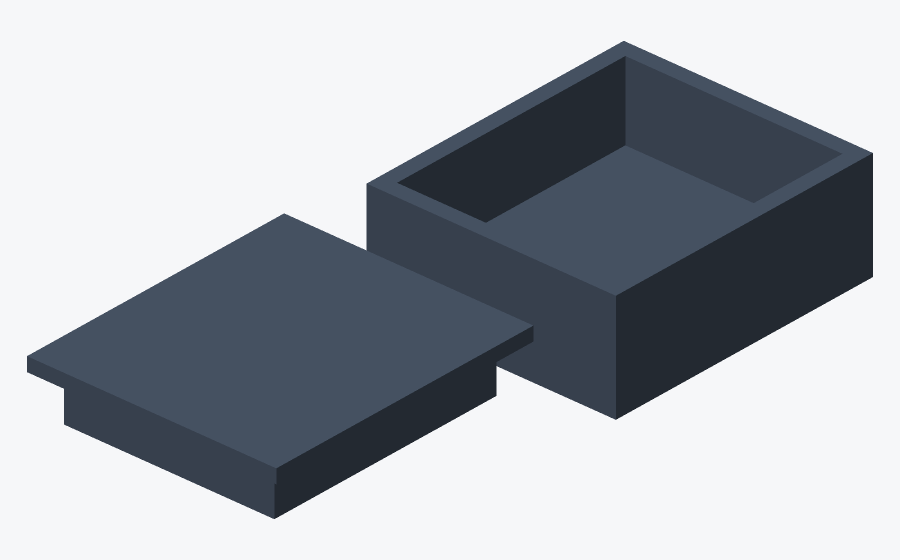

# Interlock Ergo

[](https://github.com/jamesm/interlock-ergo/actions/workflows/build-zmk.yml)
[](LICENSE)
[](https://zmk.dev/)
[](pcb/)

A wireless 71-key split ergonomic keyboard that **docks into one rigid keyboard**.
The two halves carry matching dovetail tabs and flush N52 magnets: lower one onto
the other and the joint closes, lift one and they separate. Both halves talk to a
USB dongle over low-power Bluetooth LE, so the host sees one ordinary USB HID
keyboard with no pairing and no drivers.

Two complete hardware variants are published, each with its own PCB and plate:

| | **Choc v1** | **Cherry MX** |
|---|---|---|
| Pitch | 18.0 × 17.0 mm | 19.05 × 19.05 mm |
| Plate | 1.2 mm | 1.5 mm |
| Case height | 14.2 mm | 16.0 mm |
| Case, docked | 368.2 × 137.6 mm | 386.6 × 147.8 mm |



---

## What makes it different

1. **It becomes one keyboard.** The left half carries two dovetail tabs on its
   seam face; the right half has the matching blind sockets. Four 6×3 mm N52
   magnets, flush with the seam faces, hold the joint closed. The undercut profile
   carries the load in tension and shear, so the seam behaves as one panel rather
   than two cases pushed together.
2. **A real USB keyboard, wirelessly.** A XIAO nRF52840 dongle is the ZMK split
   central and enumerates as a plain USB HID device. The halves reach it over
   Bluetooth LE at 2.4 GHz and bond with it once; the *host* never sees a
   Bluetooth device, so there is no pairing, no driver, and nothing to re-pair
   when you move between machines. It works in BIOS/UEFI and on laptops where
   Bluetooth is locked down by policy. Bluetooth profiles remain available
   (`&out OUT_BLE`) for phones and tablets.
3. **71 keys, all 1u.** No stabilisers, no wide keys, no non-standard keycap sizes
   to hunt for. ANSI row stagger (0 / 0.5 / 0.75 / 1.25 / 0.25 u) puts every letter
   column at the same offset it has on a GH60, so touch-typing transfers unchanged.
   There is no function column: 6 columns on the left and 9 on the right make the
   GH60's own 15 u, so `1`/`Q`/`A`/`Z` sit at GH60's 1.0/1.5/1.75/2.25 u exactly.
   The PCB, plate and case share one band stack, so the silhouette steps with the
   stagger and hugs the keys instead of being a rectangle with dead copper down one
   side of every row. The seam face stays a straight plane - it is the joint.



The diagram above is generated from the same constants the CAD and the PCB use
(`node docs/generate_layout.js`), so it cannot drift away from the hardware. Two
consequences of the straight seam that are worth knowing before you build:

- The row stagger needs 22.5 mm of horizontal shear. With a straight seam that
  shear ends up as dead case width on each half's seam edge, so the **centre gap
  between `5` and `6` is 69.1 mm (3.8 u)**, not the ~1.5 u of a normal staggered
  board. It is the same on every row. That is the price of a straight seam plane;
  a stepped seam would close it and is on the roadmap.
- `6`, `Y`, `H` and `N` all land on the right half (red column in the diagram),
  which is the usual convention for 6-column splits and matches ANSI.

---

## The parts

| | |
|---|---|
|  |  |
| Left half: seam face with the two dovetail tabs, USB-C window with its overmold relief, and the open controller bay | Right half: blind dovetail sockets and flush magnet pockets in the seam wall |
|  |  |
| Underside: four M2 bosses with the PCB mounts, cell recess in the controller bay | Plates: 14.0 mm switch apertures, stepped outline |
|  | |

Every STL in `cad/dist/` is gated by `tests/test_models.js`, which fails the
build if a part is more than one shell, is not watertight, or its dimensions
disagree with the stackup in `cad/interlock_params.scad`.

---

## Layout

```
[Esc  ] [1    ] [2    ] [3    ] [4    ] [5    ]  ‖ [6    ] [7    ] [8    ] [9    ] [0    ] [-    ] [=    ] [Bksp ] [Home ]
   [Tab  ] [Q    ] [W    ] [E    ] [R    ] [T    ]  ‖ [Y    ] [U    ] [I    ] [O    ] [P    ] [[    ] []    ] [\    ] [End  ]
     [Caps ] [A    ] [S    ] [D    ] [F    ] [G    ]  ‖ [H    ] [J    ] [K    ] [L    ] [;    ] ['    ] [Enter]
        [Shift] [Z    ] [X    ] [C    ] [V    ] [B    ]  ‖ [N    ] [M    ] [,    ] [.    ] [/    ] [Shift] [Up   ] [Del  ] [PgUp ]
  [Ctrl ] [Win  ] [Alt  ] [Space] [Fn1  ]  ‖ [Space] [Alt  ] [Fn1  ] [Ctrl ] [Left ] [Down ] [Right] [PgDn ]
```

Printed by `node docs/generate_layout.js` straight out of the keymap, with each
row indented by its ANSI stagger. 71 keys: 29 left + 42 right, in a 5 × 15 matrix.
`docs/kle_layout.json` is the same layout as a Keyboard-Layout-Editor file, and
`docs/matrix_and_pinout.md` has the electrical side. There is no function column
and no rotary encoder: both went when the layout was pulled back onto GH60's columns,
which is also why the left half is 29 keys and not 34.

---

## Repository

```
├── .github/workflows/build-zmk.yml   # firmware build + matrix tests + PCB DRC gate
├── cad/
│   ├── interlock_params.scad         # stackup, tolerances, joint and magnet geometry
│   ├── interlock_case.scad           # the case, shared by both switch standards
│   ├── interlock_case_{choc,mx}.scad # variant wrappers
│   ├── interlock_plate.scad          # switch plate, shared by both standards
│   ├── interlock_plate_{choc,mx}.scad
│   ├── dongle_case.scad              # XIAO BLE tray + friction-fit lid
│   ├── build_models.js               # headless STL build -> cad/dist/
│   ├── render_preview.js             # headless STL -> docs/images/*.png
│   └── dist/                         # printable STLs (generated, not committed)
├── config/boards/shields/interlock_ergo/
│   ├── Kconfig.shield, Kconfig.defconfig
│   ├── interlock_ergo.dtsi           # 71-key matrix transform
│   ├── interlock_ergo_{left,right,dongle}.overlay
│   ├── interlock_ergo_{left,right,dongle}.conf
│   └── interlock_ergo.keymap         # QWERTY, Nav/Fn, Media/BLE layers
├── docs/
│   ├── architecture.md               # design rationale and the dongle topology
│   ├── assembly.md                   # build order, torque, magnet polarity, flash steps
│   ├── bom.md                        # parts with vendor links
│   ├── matrix_and_pinout.md          # GPIO map and power tree
│   ├── part-dimensions.md            # every dimension the CAD rests on, with sources
│   ├── generate_layout.js            # draws docs/images/layout.svg from the real numbers
│   └── production-readiness-audit.md # adversarial review of the current tree
├── pcb/generate_pcb.js               # KiCad board generator + router + DRC gate
├── pcb/generate_schematic.js         # .kicad_sch from the verified board, with ERC
├── pcb/*.kicad_pcb                   # four boards: {left,right} x {choc,mx}
├── pcb/dist/                         # gerbers/BOM/CPL/schematic, only for DRC-clean boards
└── tests/
    ├── test_matrix.js                # firmware matrix, Kconfig, stagger agreement
    ├── test_models.js                # mesh watertightness + dimension gate
    ├── test_alignment.js             # PCB footprints vs plate apertures vs case rebate
    └── test_fab_rules.js             # process limits + order quantity per design
```

---

## Build and verify

```bash
node tests/test_matrix.js     # firmware matrix, shield config, CAD/PCB stagger agreement
node tests/test_models.js     # every STL is one watertight shell of the right size
node tests/test_alignment.js  # PCB footprints vs plate apertures vs case rebate, sampled in the meshes
node tests/test_fab_rules.js   # JLCPCB process limits and the order quantity per design
node cad/build_models.js      # rebuild all STLs
node cad/render_preview.js    # rebuild the README renders
node docs/generate_layout.js  # rebuild the layout diagram
node pcb/generate_pcb.js      # regenerate boards; DRC-clean boards emit fab files
node pcb/generate_schematic.js # regenerate the .kicad_sch files and their ERC/netlist gate
```

`pcb/generate_pcb.js` refuses to emit gerbers, BOM or CPL for any board that has
DRC violations or unconnected pads - **at any severity**, warnings included - and
withdraws previously published ones.
**If a gerber zip is missing from `pcb/dist/`, that board is not orderable** - fix
the routing, do not hand-build a zip from `pcb/*.kicad_pcb`.

Fabrication output is reproducible: KiCad's creation timestamps are pinned, so two
runs from the same sources produce byte-identical gerbers and a "gerbers changed"
diff always means the copper changed.

All of the above run in CI, including the DRC gate.

---

## Bill of materials

Full sourcing with vendor links: [docs/bom.md](docs/bom.md).

| Item | Qty | Notes |
|---|---|---|
| nice!nano v2 | 2 | one per half, castellated or socketed |
| Seeed XIAO nRF52840 (BLE) | 1 | USB dongle (central) |
| Kailh Choc v1 PG1350 **or** Cherry MX switches | 71 | pick one variant, not both |
| Kailh hotswap sockets | 71 | Choc `CPG135001S30` / MX `CPG151101S11`. The pin holes are unplated: **hotswap only**, switches cannot be soldered in directly |
| 1N4148W SOD-123 | 71 | one per key |
| MSK-12D19 slide switch | 2 | power, one per half |
| JST-PH 2.0 | 2 | cell connector |
| Protected LiPo pouch, LP402030 (4 × 20 × 30 mm cell) | 2 | ~200 mAh, **must** have a PCM — the PCM adds ~3.2 mm, so allow 34 mm overall |
| 6 × 3 mm N52 disc magnets | 4 | two per seam |
| M2 × 5 self-tapping screws | 8 | four per half |
| Plates | 1 pair | 3D printed, or 1.2 mm FR4 for Choc |

Battery reality check: the controller bay takes a 4.5 mm pack, and the documented
402030 is a **200 mAh** cell — not 250. With `CONFIG_ZMK_IDLE_SLEEP_TIMEOUT=900000`
that is roughly **1-2 weeks between charges**, not months. A bigger cell needs a
taller `standoff_h` in `cad/interlock_params.scad` and a re-print of both halves.

---

## Manufacturing

### PCBs

1. `node pcb/generate_pcb.js`. Only DRC-clean boards are written to `pcb/dist/`.
   `node pcb/generate_schematic.js` then emits the matching `.kicad_sch` and fails if
   its netlist disagrees with the board.
2. Order from JLCPCB: 2 layers, 1.6 mm, 1 oz copper, ENIG recommended for the
   hotswap pads, at the quantity in item 3 (5 pcs crosses the 650 cm² order-area
   threshold and adds a large-order surcharge).
3. **Quantity per design, not one number for everything.** The order-area budget is
   650 cm² and the boards are different sizes, so the right quantity differs:
   left Choc 3 pcs, right Choc 2, left MX 2, right MX 2. `node tests/test_fab_rules.js`
   prints the numbers for however you regenerate the boards - re-check them on the
   live JLCPCB quote, since the thresholds and fees change.
4. `bom_*.csv` / `cpl_*.csv` are only emitted for diodes, and the gerber zip
   carries the `B.Paste` stencil layer for them. Order them placed, or hand-solder
   them with everything else (sockets, headers, JST, slide switch) - hand-soldering
   is cheaper than JLCPCB's per-order PCBA fees at this volume.
5. Order both design variants only if you intend to build both; each half is a
   separate board because the halves are 34 and 42 keys and cannot be reversible.

### Printing

- PETG, 0.16 mm layers, 4 perimeters, 20% gyroid.
- Cases: print with the floor down. The seam tabs and the bay are vertical walls,
  so nothing needs support; only the two magnet pockets bridge, over 3.2 mm.
- Plates: 1.2 mm (Choc) / 1.5 mm (MX) exactly. Do not scale.
- Dongle: `dongle_case_base.stl` + `dongle_case_lid.stl`.
- Bed size: the left case is 178 × 138 mm, the right 211 × 138 mm, so a 220 × 220
  bed fits the left half and a 256 × 256 bed fits both.

### Assembly

See [docs/assembly.md](docs/assembly.md). The order matters: solder the sockets
and diodes on the **bottom** of the PCB, screw the PCB to the four bosses, then
drop the plate in **last** - the switches hold the plate down.

---

## Firmware

CI builds all three shields. Download the artifact zip, then flash:

| Board | File |
|---|---|
| left half (nice!nano v2) | `interlock_ergo_left-nice_nano_v2-zmk.uf2` |
| right half (nice!nano v2) | `interlock_ergo_right-nice_nano_v2-zmk.uf2` |
| dongle (XIAO BLE) | `interlock_ergo_dongle-seeeduino_xiao_ble-zmk.uf2` |

CI also builds the dongle shield for `nice_nano_v2` and `nrf52840dongle_nrf52840`.
Those are firmware-only targets: the printed dongle case fits the XIAO, and the
Nordic USB-A dongle is a stick with no enclosure.

Double-tap reset to enter the UF2 bootloader and copy the file across. The dongle
bonds with both halves on first boot.

If the halves stop connecting after a reflash or a controller swap, flash
`settings_reset` on both halves and re-pair - it is built by the same workflow.

Local builds with Nix are available from `flake.nix`
(`nix build .#firmware-left`, `.#firmware-right`, `.#firmware-dongle`, `.#cad`, `.#pcb`,
or just `nix build` for the full release package).

All three shields are built and checked in CI. Two firmware details are pinned
rather than left to chance:

- `config/west.yml` pins ZMK **v0.2** (Zephyr 3.5).
- `flake.nix` pins the ARM compiler to **GCC 13**. nixpkgs' current
  `gcc-arm-embedded` is GCC 15, which rejects ZMK v0.2's `int` → `void *`
  `user_data` cast in `central_bas_proxy.c` as a hard error. Upstream only fixed
  that after v0.3.0 ([zmkfirmware/zmk#3105](https://github.com/zmkfirmware/zmk/pull/3105)).
  Move both pins together when you bump ZMK.

---

## Status

Every gate in this repository passes: the firmware matrix, the 3D-printed parts,
the plate/case/PCB alignment, the PCB DRC gate, and the fabrication-rule limits. All four boards route clean and
their JLCPCB gerber/BOM/CPL packages are in `pcb/dist/`.

What has *not* happened is a physical build. Nothing here has been printed,
soldered or typed on. Before ordering PCBs, print one half and dry-fit it - see
step 1 of [docs/assembly.md](docs/assembly.md).

Known limitations, in full: [docs/production-readiness-audit.md](docs/production-readiness-audit.md)
(69 mm docked centre gap, 200 mAh cell ceiling, no ESD/TVS protection).

Every mechanical dimension the CAD rests on, and where it came from:
[docs/part-dimensions.md](docs/part-dimensions.md).

## License

MIT. See [LICENSE](LICENSE).
